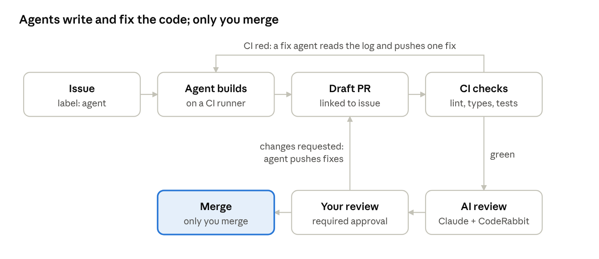
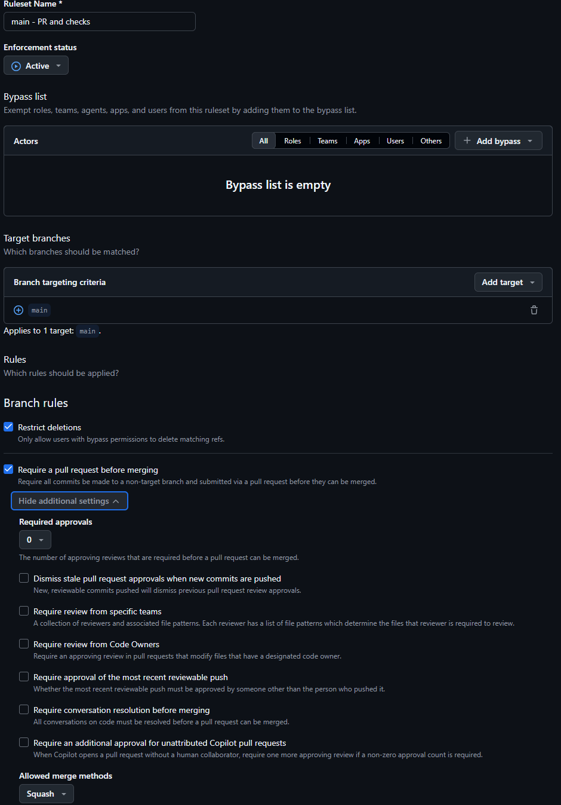
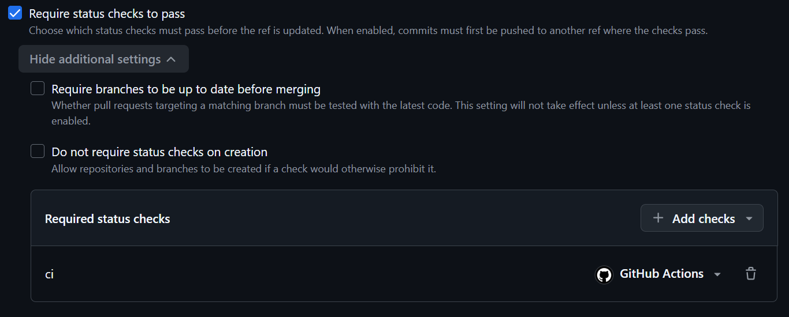
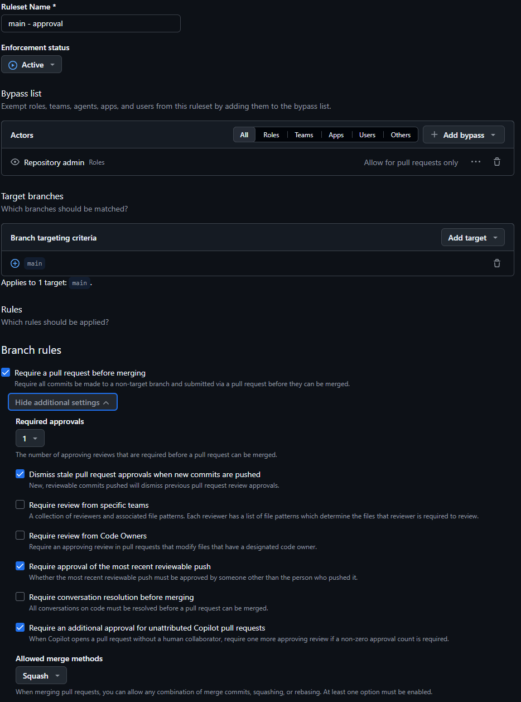
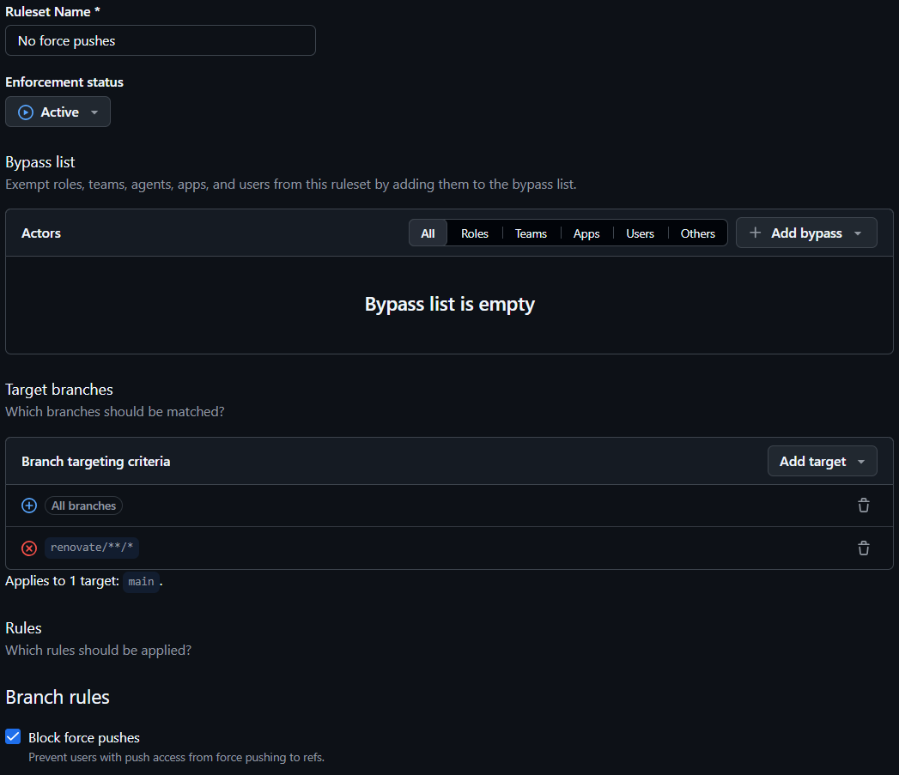
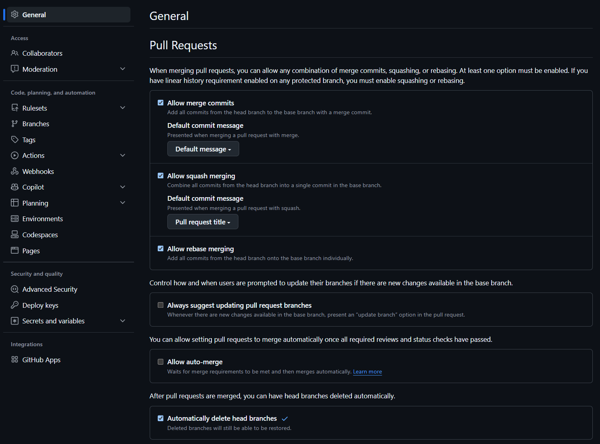

# Agents-Driven Flow: Project Plan

Nov 4, 2026 (updated Nov 11, 2026) · @Mishel

## Goal

Build one public TypeScript monorepo where agents do most of the development work and you act as tech lead: you write the issues, set the rules, review and merge. The repo should run the main agent workflows engineering orgs use today, so you learn where agents help, where they fail, and what it takes to make them reliable.

The project serves three purposes:

- **Agent engineering:** real evidence for agent environments, MCP integrations, an AGENTS.md you own, enablement, and measured results.
- **Full-stack practice:** React and TypeScript on a real product UI.
- **Measured results:** before/after numbers from a fixed task set.

**Done means:** a public repo anyone can clone and run, a write-up with before/after numbers from a fixed task set, and a list of failures you found and fixed.

## The app: a small audience sync tool

A common data product: marketers define an audience from customer data, preview it, and sync it to an ad platform. It's small enough for agents to build in days, and it covers the core data-sync problems: batching, retries, rate limits and idempotency.

**Features (MVP):**

- **Customer data:** a seeded Postgres table of customers and events (purchases, page views), about 100k generated rows.
- **Audience builder (React):** a filter builder ("purchased in last 30 days AND country = DE"), a live count, and a paginated member table.
- **Sync jobs:** sync an audience to a mock ad platform that enforces rate limits and fails some requests. Batching, retries with backoff, idempotent writes.
- **Run history:** a page listing each sync run with status, counts and errors.

**Stack:**

| Part | Choice | Why |
| --- | --- | --- |
| Monorepo | pnpm workspaces + Turborepo | Standard tooling for a TypeScript monorepo |
| Frontend | React + TypeScript (Vite), TanStack Query | Widely used; React practice on a real UI |
| API | Node.js + TypeScript, GraphQL Yoga (schema-first) | Same language as the frontend; GraphQL gives the filter builder a typed API |
| Sync worker | Small Node.js + TypeScript service | One language across the stack, so you can review every line the agents write |
| Data | Postgres via Docker Compose | Simple; the only part in Docker, so agents can run and restart the apps directly |
| Mock destination | Tiny Node server with rate limits and random failures | Gives the sync worker real failure cases |
| Tests | Vitest, Playwright (e2e + screenshots) | Agents need fast checks to verify their own work |

Keep the product small. The point is the agent setup around it, not the feature count.

**Nothing to host.** Postgres runs in Docker Compose; the web app, API, sync worker and mock ad platform run as Node processes with `pnpm dev`. Everything runs locally (your machine and the dev container) and in CI. Every outside service in this plan (GitHub, CodeRabbit, Renovate, Sentry) is a hosted product with a free tier, so there is no server for you to run or pay for.

## How companies use agents today, and what this project copies

Agents now cover the whole lifecycle, not just writing code. In Anthropic's 2026 State of AI Agents report (published December 2025), organizations reported time savings in planning (58%), code generation (59%), documentation (59%), and code review and testing (59%) ([Claude blog](https://claude.com/blog/how-enterprises-are-building-ai-agents-in-2026)). The Pragmatic Engineer's 2026 survey of 900+ engineers also reports pain in reviewing AI-generated output ([summary](https://engineered.at/articles/ai-s-impact-on-software-engineers-in-2026-key-trends-part-2)).

The reference case is [Stripe's Minions](https://www.lennysnewsletter.com/p/how-stripe-built-minionsai-coding): about 1,300 agent-written PRs per week, with humans mostly doing review. They run on the cloud dev environments, CI and internal docs that Stripe's developer productivity team had already built ([ZenML case study](https://www.zenml.io/llmops-database/ai-powered-developer-productivity-with-minions-and-machine-to-machine-payments)), plus an internal MCP server with nearly 500 tools, where each agent gets only a small default subset ([summary](https://news.lavx.hu/article/inside-stripe-s-minions-how-ai-agents-are-rewriting-code-at-scale)). This project copies that setup at a smaller scale. Anthropic's AI-native SDLC playbook (August 2026) describes the same loop: plan, build, test, layered AI review, with humans approving at gates.

| Stage | What teams do with agents | Industry example | In this project |
| --- | --- | --- | --- |
| Plan | Turn an issue into a plan before any code | [Copilot cloud agent](https://github.blog/changelog/2026-04-01-research-plan-and-code-with-copilot-cloud-agent/) writes a plan for review before any code, when you ask for one | Plan mode locally; for features in GitHub, a plan on the issue that you approve with the agent label |
| Build locally | Agent in a terminal, IDE open to review its changes | Common day-to-day setup | Claude Code interactive; parallel sessions in git worktrees |
| Delegate (issue to PR) | Assign an issue, get a PR back | [Copilot cloud agent](https://github.blog/ai-and-ml/github-copilot/whats-new-with-github-copilot-coding-agent/); [Claude Code Action](https://code.claude.com/docs/en/github-actions) on @claude, assignee or label | Label `agent` on an issue, agent opens a draft PR |
| AI code review | First-pass review on every PR | [Copilot code review](https://learn.microsoft.com/en-us/training/modules/get-started-github-copilot/3-compare-github-copilot-plans), [CodeRabbit](https://docs.coderabbit.ai/configuration/auto-review), Claude Code Action | Claude on every PR; CodeRabbit when you trigger it; Copilot review optional |
| Fix failing CI | Agent reads the failed step and pushes a fix to the PR branch | [Elastic's self-correcting PRs](https://www.elastic.co/search-labs/blog/ci-pipelines-claude-ai-agent) | On CI failure: diagnosis comment, optional fix commit |
| Dependency updates | Bot opens upgrade PRs, agent fixes the breaking ones | Elastic + Renovate; [Ona](https://ona.com/docs/examples/ai-agent-use-cases/fixing-dependencies.md) | Renovate + the CI-fix agent |
| Security review | Extra review when sensitive paths change | Path-triggered security review ([guide](https://github.com/FlorianBruniaux/claude-code-ultimate-guide/blob/main/guide/workflows/github-actions.md)); [/security-review](https://code.claude.com/docs/en/security) | Security review when `services/sync-worker/`, `.github/`, `.devcontainer/`, `.claude/` or config files change |
| Tests | Generate and extend tests, check UI visually | 59% report time savings in code review and testing ([Anthropic report](https://claude.com/blog/how-enterprises-are-building-ai-agents-in-2026)) | A test-writing skill; Playwright screenshots the agent looks at |
| Triage and maintenance | Label issues, sync docs, scheduled repo checks | Listed use cases of [Claude Code Action](https://github.com/anthropics/claude-code-action) | Issue triage on open; weekly docs-sync job |
| Tool access (MCP) | Agents query CI, logs, tickets | Stripe Toolshed (above) | Official GitHub MCP + one custom MCP server |
| Cloud environments | Isolated, parallel environments for agents | Stripe devboxes | Dev container with a firewall; headless runs inside it; the same config in Codespaces |
| Non-engineers | People outside engineering request small changes | — | Issue form: change request in, PR with screenshots out |

## Repo structure and agent configuration

Everything an agent needs lives in the repo, so any engineer, agent or CI job gets the same setup from a clone.

```
agents-review/
├── AGENTS.md                  # shared rules for every agent tool (you write it by hand)
├── CLAUDE.md                  # @AGENTS.md + Claude-specific rules
├── REVIEW.md                  # review rules for Claude, CodeRabbit and Copilot review
├── apps/
│   ├── web/                   # React app
│   │   ├── AGENTS.md          # UI rules (Copilot reads it directly)
│   │   └── CLAUDE.md          # one line: @AGENTS.md (so Claude reads it too)
│   └── api/                   # GraphQL API
├── services/
│   ├── sync-worker/           # TypeScript (Node.js)
│   └── mock-destination/
├── packages/shared/           # types, GraphQL schema
├── packages/db/               # Drizzle schema, migrations, seed
├── tools/mcp-dev/             # your custom MCP server (runs locally over stdio)
├── docs/private/              # your notes and agent log (gitignored)
├── .claude/
│   ├── settings.json          # permissions, hooks
│   ├── hooks/                 # hook scripts in Node (test lock, protected files)
│   ├── rules/                 # Claude-only path-scoped rules
│   ├── skills/                # write-issue, fix-bug, write-tests, screenshot-ui, add-graphql-field
│   └── agents/                # reviewer subagent
├── .mcp.json                  # team-shared MCP servers
├── .coderabbit.yaml           # CodeRabbit settings
├── renovate.json              # Renovate schedule and grouping
├── .devcontainer/             # container + egress firewall
└── .github/
    ├── workflows/             # CI + agent workflows (next section)
    └── ISSUE_TEMPLATE/        # issue forms: feature, bug, visual change
```

**What each file does:**

- **AGENTS.md:** stack, how to run, test and lint everything (one command each), package boundaries, conventions, "never do" rules, definition of done. Keep it short and concrete. Claude Code reads AGENTS.md only when no CLAUDE.md exists, so CLAUDE.md imports it with `@AGENTS.md` ([docs](https://code.claude.com/docs/en/memory)).
- **Nested AGENTS.md:** frontend rules live in `apps/web/AGENTS.md`. Copilot reads nested AGENTS.md files natively ([changelog](https://github.blog/changelog/2025-08-28-copilot-coding-agent-now-supports-agents-md-custom-instructions)). Claude doesn't when a CLAUDE.md sits above them, as it does here, so each nested AGENTS.md gets a one-line CLAUDE.md next to it with `@AGENTS.md` ([docs](https://code.claude.com/docs/en/memory)). Claude-only rules go in `.claude/rules/`. This keeps the root file small.
- **Skills:** repeatable workflows the agent pulls in when relevant, such as writing tests in the repo's style, screenshotting a UI change, adding a GraphQL field end to end, or turning rough notes into a standard issue (write-issue). Deploy-type skills get `disable-model-invocation: true` ([docs](https://code.claude.com/docs/en/skills)).
- **Hooks (`settings.json`):** enforcement, because instructions are only context. Typecheck and lint after edits; a Stop hook that exits with code 2 sends Claude back to work while the checks fail. Claude Code ends the turn after 8 blocks in a row, but the count resets each time Claude calls a tool, so `--max-turns` is the real limit in headless runs ([docs](https://code.claude.com/docs/en/hooks)). A PreToolUse hook also returns `ask` for edits to AGENTS.md, CLAUDE.md, REVIEW.md and `.claude/`: in a session you get a prompt, and a `claude -p` run is denied. It overlaps the `ask` rules in `settings.json` on purpose, as a second layer. Hook scripts are written in Node, so they run on Windows, in the dev container and in CI.
- **Failing test first (`fix-bug` skill + hook):** for a bug, the skill writes a test that reproduces it, runs it to confirm it fails, then creates a gitignored lock file in the repo root (outside `.claude/`, which the protected-files hook guards). While the lock exists, a PreToolUse hook blocks Edit and Write on test files, so the agent fixes the code instead of weakening the test. The skill removes the lock when the fix passes. The hook only covers the Edit and Write tools, so CI backs it up: on PRs labelled `bug`, the PR's new tests must fail against `main` and pass on the branch. This follows the playbook's play: write a failing test first, then block edits to tests during the fix ([Anthropic playbook](https://claude.com/resources/articles/the-ai-native-sdlc-playbook)).
- **REVIEW.md:** the review policy. Three passes (bugs, security, match with the issue's acceptance criteria), what counts as Important versus a nit, at most 5 nits per review, and what to skip (lockfiles, generated files, anything CI already checks). Copilot code review reads it automatically ([GitHub docs](https://docs.github.com/en/copilot/how-tos/use-copilot-agents/use-code-review)). CodeRabbit auto-detects AGENTS.md and CLAUDE.md but not REVIEW.md, so list it under `knowledge_base.code_guidelines.filePatterns` in `.coderabbit.yaml` ([CodeRabbit docs](https://docs.coderabbit.ai/knowledge-base/code-guidelines)). The Claude Code Action doesn't read it either, so the Claude review prompt tells it to apply REVIEW.md ([Claude docs](https://code.claude.com/docs/en/code-review-customize)).
- **Permissions:** deny what AGENTS.md says never to do (reading `.env`, force pushes, editing generated code, npm and yarn), ask before what it says to ask about (dependencies, the DB schema, agent config, `.github/`), and allow the test and lint commands without prompts. `docs/private/` is denied. In a `claude -p` run nobody can answer a prompt, so every `ask` rule acts as a deny, even with `--dangerously-skip-permissions` ([docs](https://code.claude.com/docs/en/permission-modes)). The built-in Bash sandbox is not part of the shared settings: it doesn't run on native Windows, and the dev container is the boundary for unattended runs. In WSL you can turn it on for yourself with `/sandbox` ([docs](https://code.claude.com/docs/en/sandboxing)).
- **Reviewer subagent:** checks a diff against AGENTS.md before you look at it.
- **`.mcp.json`:** GitHub's official MCP server, run locally from its Docker image with a fine-grained token ([repo](https://github.com/github/github-mcp-server)), plus your custom server. Limit the GitHub server with `--toolsets` (or `--read-only`), so agents get no merge tool. Shared with everyone who clones ([docs](https://code.claude.com/docs/en/claude-directory)).
- **Dev container:** start from Anthropic's reference container. Its default-deny firewall is what makes fully unattended runs reasonable ([docs](https://code.claude.com/docs/en/sandbox-environments)).
- **Copilot (optional comparison):** its cloud agent reads AGENTS.md natively, so one file serves both tools and no `copilot-instructions.md` is needed ([changelog](https://github.blog/changelog/2025-08-28-copilot-coding-agent-now-supports-agents-md-custom-instructions)). This is the cross-tool part of the setup.

## Agent workflows to build

Every change goes through one flow: issue → agent PR → checks → your review → merge. Agents push only to their own branches. GitHub rulesets block direct pushes to `main`, and only you merge.



Both loops send work back to an agent, not to you. You only see a PR once CI is green and the AI reviewers have commented.

**Main flow** (every feature and bug fix)

| Step | Trigger | Agent | You |
| --- | --- | --- | --- |
| 1 | Issue opened | Claude labels it and asks for missing acceptance criteria | Draft it with the write-issue skill; answer its questions |
| 2 | You add the `agent` label. For features, first comment `@claude plan`: Claude posts a plan on the issue, and adding the label approves it | Claude creates a branch, follows the approved plan, builds, runs tests and pushes; a workflow step opens the draft PR | Features: read the plan, fix it with a comment if needed, then add the label |
| 3 | CI fails | Claude reads the failed log and pushes one fix | Take over if it fails again |
| 4 | CI passes | A workflow marks the PR ready for review, then Claude reviews it against REVIEW.md. CodeRabbit reviews it too once you trigger it (see Known setup traps). If the PR touches `services/sync-worker/`, `.github/`, `.devcontainer/`, `.claude/` or config files, Claude also runs a security review and labels risky PRs | Comment `@coderabbitai review`; read the reviews; check labelled PRs closely |
| 5 | You comment `@claude …` | Claude commits the requested changes to the same branch | Review and ask for changes |
| 6 | You're done reviewing | — | Merge. The PR was opened under your account, so you can't approve it: merge through your approval bypass. CI must be green |

**Side flows** (PRs that don't start from your issues; each joins the main flow at step 3)

| Flow | Trigger | Agent | You |
| --- | --- | --- | --- |
| Dependency update | Renovate opens an upgrade PR (weekly) | If CI fails, the step 3 agent adapts the code | Review and merge |
| Docs sync | Weekly schedule (GitHub pauses it after 60 days without repo activity) | Claude compares docs to code and opens a PR with fixes | Review and merge |
| Visual change | Someone files the "visual change" form; you add the agent label | Claude edits copy or styles in `apps/web` and adds before/after screenshots to the PR | Check the screenshots, merge |

**Always on, no AI:** CodeQL, secret scanning and Dependabot alerts scan the repo automatically.

**Optional: Copilot comparison.** This needs Copilot Pro at $10 for one month, because GitHub paused the free Pro trial in April 2026 ([changelog](https://github.blog/changelog/2026-04-10-pausing-new-github-copilot-pro-trials/)). Nothing else in this plan depends on it, and Copilot does nothing in the repo unless you subscribe and then assign it an issue or request its review, so skipping it needs no change. If you do it: run 2–3 of the same issues through the Copilot cloud agent (renamed from "coding agent" in 2026), and request Copilot review on about 5 PRs. For each tool, note where it beats Claude, and count real defects vs noise in its reviews. That's how you learn which agent fits which job.

**Known setup traps** (check these in Phase 4):

- **Token:** don't pass `github_token: ${{ secrets.GITHUB_TOKEN }}` to the action. Without it, the action pushes as the Claude GitHub App and CI runs on its commits; pushes made with `GITHUB_TOKEN` don't trigger workflows ([Claude docs](https://code.claude.com/docs/en/github-actions)).
- **Opening the PR:** by default the action pushes a branch and posts a link; you create the PR ([action security docs](https://github.com/anthropics/claude-code-action/blob/main/docs/security.md)). To open the draft PR automatically, use a workflow step with a fine-grained personal token. A PR opened with `GITHUB_TOKEN` waits for you to click "Approve workflows to run" before CI starts ([GitHub docs](https://docs.github.com/en/actions/how-tos/write-workflows/choose-when-workflows-run/trigger-a-workflow)).
- **Bots:** the action refuses runs started by bots unless they're in `allowed_bots`. The CI-fix and review workflows run on `workflow_run`, whose actor is whoever pushed, so list `claude[bot]` and `renovate[bot]` there. That also removes the built-in loop guard, so enforce the one-fix-attempt limit yourself.
- **Who can trigger:** issue and PR events need a user with write access, so strangers' issues don't start any run. Leave `allowed_non_write_users` off.
- **Review permissions:** the auto-generated review workflow has shipped with `pull-requests: read`, so reviews finished without posting ([issue #944](https://github.com/anthropics/claude-code-action/issues/944)).
- **CodeRabbit:** on a public repo with fewer than 10 stars, CodeRabbit doesn't review on its own. Click **Trigger review** in its status comment or comment `@coderabbitai review`. The open-source plan allows 1–10 reviews per hour depending on stars ([plans](https://docs.coderabbit.ai/management/plans)).
- **Copilot PRs (optional comparison):** workflows don't run on Copilot's pushes until you click "Approve and run workflows", unless you change that in Copilot's settings ([GitHub docs](https://docs.github.com/en/copilot/how-tos/use-copilot-agents/cloud-agent/review-copilot-prs)).
- **Screenshots:** CI can't paste images into a PR comment directly. Upload them as a workflow artifact and link it, or commit them to a `screenshots` branch and embed from there.
- **Plan gate:** the label-triggered run must build from the approved plan. Tell it in the workflow prompt to read the issue's comments with `gh issue view --comments`, and confirm on one feature that it does.

Write down what you hit. Debugging this is half of what the project teaches.

## Tools (all free)

Everything below costs $0 as long as the repo stays public. The one paid extra is optional: a month of GitHub Copilot Pro ($10) for the Copilot comparison. Copilot Free leaves out the cloud agent and PR review ([GitHub plans](https://docs.github.com/en/copilot/get-started/plans), [plan comparison](https://learn.microsoft.com/en-us/training/modules/get-started-github-copilot/3-compare-github-copilot-plans)), and the free Pro trial has been paused since April 2026.

| Job | Pick | Why this one | Free limit |
| --- | --- | --- | --- |
| Main agent (local + headless) | Claude Code | Your license; the plan is built around it | Your plan's usage limits, so run evals in batches |
| Agent workflows in GitHub | [Claude Code Action](https://code.claude.com/docs/en/github-actions) with an OAuth token from `claude setup-token` | Official action: issue to PR, @claude, review, CI fix, triage, docs sync | Runs use your Claude subscription, not API billing; Actions minutes are free on public repos with standard runners ([GitHub](https://github.com/resources/insights/2026-pricing-changes-for-github-actions)) |
| Second agent + reviewer (optional) | Copilot cloud agent and Copilot code review (Copilot Pro) | Used by 56% of respondents at companies with 10k+ employees ([Pragmatic Engineer](https://newsletter.pragmaticengineer.com/i/189777574/1-interesting-findings)) | Not free: $10 for one month ([GitHub](https://docs.github.com/en/copilot/get-started/plans)); review on about 5 PRs only; cancel before it renews |
| Second AI reviewer | [CodeRabbit](https://aicodereview.cc/blog/coderabbit-pricing) | Dedicated review tool, configured in `.coderabbit.yaml` | Free on public repos only (open-source plan). Under 10 stars you trigger each review yourself; 1–10 reviews per hour ([plans](https://docs.coderabbit.ai/management/plans)) |
| Security scanning | CodeQL code scanning, secret scanning with push protection, Dependabot alerts | Built into GitHub; just switch them on | Free on public repos ([GitHub docs](https://docs.github.com/en/get-started/learning-about-github/about-github-advanced-security)) |
| Dependency updates | [Renovate](https://github.com/marketplace/renovate) (Mend app) | Groups related upgrades in a monorepo; pairs with the CI-fix agent | Free plan covers public and private repos |
| GitHub tools for agents | [GitHub MCP server](https://github.com/github/github-mcp-server) | Official; runs locally from its public Docker image | Free and open source; needs only a fine-grained token |
| Cloud dev environment | [GitHub Codespaces](https://docs.github.com/en/billing/concepts/product-billing/github-codespaces) | Runs the same `devcontainer.json` as local Docker | 120 core-hours/month on a personal account (60 hours on 2 cores) |
| Local isolation | Docker + Anthropic's reference dev container | Default-deny firewall for unattended runs | Free |
| Error monitoring + MCP (optional) | [Sentry](https://docs.sentry.io/ai/mcp/) Developer plan + Sentry's hosted MCP server | Agents query real error data through MCP | Free plan for 1 user, with 5k errors and MCP access included ([pricing](https://sentry.io/pricing/)); the hosted MCP server needs no install |
| Tests and data | Vitest, Playwright, Postgres in Docker | Standard and open source | Free |

**Keep it at $0:**

- Keep the repo public. CodeRabbit, CodeQL, secret scanning and free Actions minutes all depend on it.
- Authenticate the Claude Code Action with your subscription's OAuth token, never an API key, so nothing bills per call.
- The Copilot comparison is the only paid step. If you do it, subscribe at the start of Phase 4, so one month covers the build and the evals, and set a reminder to cancel.
- Run AI review once per PR, after CI passes, and set `--max-turns` on every headless run, so you stay inside your plan's limits. Use standard runners such as ubuntu-latest; larger runners are billed even on public repos.
- Skipped on purpose: Gemini Code Assist's free GitHub reviewer, which shut down on July 17, 2026 ([Google](https://developers.google.com/gemini-code-assist/docs/deprecations/consumer-code-review)).

## Build plan

Eight phases, done in order. There's no fixed timeline: each phase takes as long as it takes. If time runs short, cut Phase 6's custom MCP server to one tool and skip the docs-sync job, but keep Phase 7: the evals are what make the project count.

**You** = done by hand: accounts, GitHub settings, tokens, writing issues and rules, reviewing. **Agent** = Claude Code does it and you review the result. Log every agent failure in `docs/private/agent-log.md` with the cause and the fix; it's the most useful part of the final write-up.

**Phase 1: Foundations**

- ✅ **You:** create the public repo `agents-review` and push the first commit to `main`. Then add three rulesets in GitHub **Settings → Rules → Rulesets** (why: see Guardrails): (1) on `main`: require a PR (0 approvals), block force pushes, restrict deletions, no bypass; (2) on `main`: require 1 approval, with Repository admin (you) as the only bypass in "For pull requests only" mode; (3) on all branches except `renovate/**/*`: block force pushes. On the first PR, confirm the bypass skips only the approval rule.
- ✅ **You:** add README.md (what, why, structure) and AGENTS.md, from the drafts kept with this plan.
- ✅ **You:** add CLAUDE.md (one line: `@AGENTS.md`) and a `.claude/settings.json` that denies reading `.env` and `git push --force`. Guardrails go in before the first agent run.
- ✅ **Agent drafts, you edit:** issue forms (feature, bug, visual change) and the `write-issue` skill.
- ✅ **You:** write the scaffold issue with `write-issue`. Done means every AGENTS.md command passes on a fresh clone. One-time setup rules go in this issue, not in AGENTS.md: ports from env with defaults in `.env.example`, Vite `strictPort` and a `/graphql` proxy, Yoga with one hello query, codegen wired, Oxlint and Oxfmt, a Vitest config per package, one Playwright smoke test, Postgres in Compose, `db:*` scripts present but no tables yet, Node and pnpm versions pinned.
- ✅ **Agent:** build the scaffold locally in plan mode. **You:** approve the plan before it writes code.
- ✅ **You:** run every AGENTS.md command by hand. Where reality and AGENTS.md differ, fix one of them and log it.
- ✅ **Agent:** CI workflow (lint, typecheck, tests, codegen check). **You:** make CI a required status check in ruleset (1), the one with no bypass.

**Phase 2: Environment and guardrails**

- ✅ **Agent drafts, you review:** dev container from Anthropic's reference, with the firewall allowlist adjusted for this repo.
- ✅ **You:** open the same config in Codespaces once. If the firewall won't start there, keep unattended runs local.
- [ ] **Agent drafts, you review:** permissions in `.claude/settings.json` (allow test and lint commands) and hooks: lint and typecheck after edits, a Stop hook while checks fail, the protected-files hook. Hook scripts in Node.
- [ ] **You:** run one headless task in the container (`claude -p ... --max-turns ... --dangerously-skip-permissions`) and confirm it can run the full test suite, and that an edit to AGENTS.md is denied.
- [ ] **You:** draft the 12 eval tasks (see Measurement), before Phase 3 shows what the setup is good at. Keep them, and later their hidden tests, in the private evals repo `agents-review-evals`.

**Phase 3: Product features through issues**

- [ ] **You:** write 6 issues with `write-issue`: data model with seed data (about 100k rows; this issue also starts Postgres in the CI `e2e` job, which has none today), GraphQL API, audience builder UI, member table, sync worker with the mock destination, run history page.
- [ ] **Agent:** build each in plan mode. Run two in parallel git worktrees, each with its own `.env` ports and database name.
- [ ] **You:** review and merge. Add `apps/web/AGENTS.md` (plus its one-line CLAUDE.md) and other rules (`.claude/rules/`) only when a mistake repeats.
- [ ] **Agent drafts, you review:** the `write-tests` and `add-graphql-field` skills and the reviewer subagent, once the first features are merged and there's a pattern to copy.
- [ ] **You:** at the end of the phase, record the current `main` commit as the eval snapshot and write the 3 eval bugs as patches, both in the evals repo. Never seed them on `main`.

**Phase 4: GitHub automation**

- [ ] **You:** start the bare eval runs on the snapshot (2 runs per task) in the background: your "before" numbers.
- [ ] **You:** install the Claude GitHub app, run `claude setup-token`, and store the token as a repo secret.
- [ ] **Agent drafts, you review:** Claude Code Action workflows: `@claude`, the `agent` label to a draft PR, review after CI passes. Work through the setup traps above.
- [ ] **You:** write REVIEW.md by hand. **Agent:** the step that restores REVIEW.md and every AGENTS.md from `main` before the Claude review.
- [ ] **You:** install CodeRabbit. **Agent:** `.coderabbit.yaml` with REVIEW.md as a guideline file. Trigger the first review by hand.
- [ ] Optional, **you:** the Copilot comparison (see Agent workflows).
- [ ] **You:** test the plan gate: comment `@claude plan` on one feature issue, correct the plan, approve it with the `agent` label.

**Phase 5: Self-healing and safety**

- [ ] **Agent drafts, you review:** CI-failure workflow: a diagnosis comment plus one fix attempt.
- [ ] **You:** install the Renovate app. **Agent:** `renovate.json` with `minimumReleaseAge` of at least 1 day, so Renovate PRs don't fail pnpm's release-age check.
- [ ] **You:** turn on CodeQL, secret scanning with push protection, and Dependabot alerts in repo settings. **Agent:** path-triggered security review and issue triage on open.
- [ ] **Agent drafts, you review:** the weekly docs-sync workflow, which opens a PR with fixes.
- [ ] **Agent drafts, you review:** `fix-bug` skill, test-lock hook, and the CI check that a bug PR's new tests fail on `main`. **You:** seed one extra bug (not an eval bug) and try it.

**Phase 6: Tools and visual checks**

- [ ] **You:** create a fine-grained GitHub token for this repo only. **Agent:** add the GitHub MCP server (Docker image) to `.mcp.json`, with its toolsets limited so there's no merge tool.
- [ ] **Agent:** custom MCP server in `tools/mcp-dev` (add `tools/*` to `pnpm-workspace.yaml`) with `get_failed_ci_log` and `get_sync_run`. Optional: **you** sign up for Sentry's free plan and connect its MCP server.
- [ ] **Agent:** `screenshot-ui` skill with Playwright, then the visual-change flow end to end.

**Phase 7: Measure**

- [ ] **You:** run the eval set on the same snapshot with the full setup, 2 runs per task.
- [ ] **You:** compare against Phase 4's bare numbers; note where the setup didn't help.
- [ ] Stretch: the `run-evals` workflow (see Measurement).

**Phase 8: Write it up**

- [ ] **Agent drafts, you edit:** README with architecture, how to run, and each workflow linked to a real PR it produced.
- [ ] **You:** a short article: what you built, the numbers, the 5 most useful failures.

## Measurement

Run the same 12 tasks twice: once with a bare setup (Phase 4) and once with the full setup (Phase 7). Both start from the same snapshot of `main`, so only the agent setup changes. Draft the tasks at the end of Phase 2, before you know what the setup is good at, so you can't pick tasks that flatter it.

**Where the evals live.** Everything for the evals sits in a private companion repo, `agents-review-evals`: task texts, bug patches, hidden tests, reference fixes, the snapshot commit, the runner and the results. Its README is the runbook. Nothing from it goes into this repo: an agent that can read a task's tests or fix can copy the answer.

**How a trial runs.** Each trial starts clean, because agents have found answers in git history and in leftovers from earlier trials ([Anthropic](https://www.anthropic.com/engineering/demystifying-evals-for-ai-agents), [SWE-bench case](https://bayes.net/swebench-hack)):

1. Export the snapshot into a new folder without its git history, and apply the task's patch (a seeded bug or a dependency bump), if it has one.
2. Remove the agent config (bare) or copy in the current one (full), then commit everything as one fresh commit.
3. Run `claude -p` headless in a fresh dev container with an empty Claude config: the same pinned model ID (`--model`), Claude Code version, prompt and `--max-turns` every time. A model alias can move to a newer model between Phase 4 and Phase 7.
4. Copy in the hidden tests, then grade: hidden tests, lint, typecheck and tests, plus your check of the acceptance criteria.

**Task set (12 tasks, each a real issue with acceptance criteria):**

- 3 bug fixes, on bugs you seed by hand at the end of Phase 3 (details in the evals repo)
- 3 small features (a new filter operator, a new column in run history, a GraphQL field end to end)
- 2 UI changes (copy and layout, checked by screenshot)
- 2 test tasks (raise coverage on the sync worker, add an e2e flow)
- 1 refactor across packages
- 1 dependency upgrade with a breaking change: the task's patch applies the version bump and lockfile, as Renovate would, and the agent adapts the code. Agents don't install or upgrade packages in unattended runs

**Two setups:**

- **Bare:** no AGENTS.md, no rules, skills, hooks or MCP, and no personal Claude config or memory. Same model and same prompt.
- **Full:** everything from this plan.

**Metrics per task:**

| Metric | How to measure |
| --- | --- |
| First-try pass | Lint, typecheck and tests pass on the agent's first attempt, with no help |
| Acceptance criteria met | Checked by you against the issue |
| Time | Minutes from start to finished change |
| Tokens | Per task, from the run's output |

Run each task twice per setup, because agent output varies run to run, and report both "passed at least once" and "passed both times". Report it honestly: 12 tasks × 2 runs is a small sample, so present it as "on my task set", not as a general claim. A clear finding where the setup didn't help is as useful as a win.

**Stretch: evals in CI.** The playbook reruns evals whenever agent config changes ([Anthropic playbook](https://claude.com/resources/articles/the-ai-native-sdlc-playbook)). A small version fits here: a `run-evals` workflow, triggered by a `run-evals` label on PRs that change AGENTS.md, REVIEW.md, skills or hooks. It builds a trial the same way as above, reading the private evals repo with a fine-grained token stored as a secret, copies in the PR's agent config, runs the 3 seeded bug tasks with the Claude CLI (`claude -p`, with the OAuth token), and grades each with its hidden tests. Actions logs on this public repo are public, so the workflow must never print task, patch or test contents. Use the CLI rather than the Claude Code Action, which loads `.claude/` from `main` on PRs and would test the old config. Treat the result as a smoke test: 3 tasks and 1 run can't measure small changes. Each run uses your Claude plan's usage limits.

## Guardrails and security

A public repo with agents that write code is an attack surface, so build these in from Phase 1.

- **Agents never merge.** Three rulesets enforce it; rulesets are free on public repos ([GitHub docs](https://docs.github.com/en/repositories/configuring-branches-and-merges-in-your-repository/managing-rulesets/about-rulesets)). When several rulesets target the same branch, their rules are combined and the strictest version applies.
  - **Ruleset "main - PR and checks":**  Add "Require status checks to pass" once CI exists (Phase 1, CI bullet).
  
  - **Ruleset "main - approval":**  An author can't approve their own PR, and on PRs you asked Copilot to create, your approval doesn't count either ([GitHub docs](https://docs.github.com/en/copilot/how-tos/use-copilot-agents/cloud-agent/review-copilot-prs)). So you merge your own and Copilot's PRs through this bypass, while the first ruleset still requires CI. Renovate PRs you approve, then merge. Confirm on the first PR that the bypass skips only the approval rule.
  - **Ruleset "No force pushes"** (all branches except `renovate/**/*`):  Renovate updates a branch by rebuilding it on top of the base branch, which needs a force push ([Renovate docs](https://docs.renovatebot.com/updating-rebasing/)).

    Agents get no merge or approve tools. Elastic's CI agent likewise only commits fixes to the PR branch ([Elastic](https://www.elastic.co/search-labs/blog/ci-pipelines-claude-ai-agent)).

  Repo-wide PR settings (**Settings → General → Pull Requests**) 

- **Only trusted people can trigger agents.** By default the Claude Code Action runs only for users with write access, and refuses bots you haven't listed in `allowed_bots`. Keep that list to `claude[bot]` and `renovate[bot]`, and never use `*` on a public repo ([action security docs](https://github.com/anthropics/claude-code-action/blob/main/docs/security.md)).
- **A PR can't rewrite its own review rules.** On PRs the action restores `CLAUDE.md`, `.claude/` and `.mcp.json` from the base branch, but not `AGENTS.md` or `REVIEW.md` ([action security docs](https://github.com/anthropics/claude-code-action/blob/main/docs/security.md)). Add a workflow step that restores REVIEW.md and every AGENTS.md from the base branch before the Claude review runs. Copilot code review reads its instructions from the PR's own branch ([GitHub docs](https://docs.github.com/en/copilot/concepts/agent-capabilities/agent-powered-workflows-and-operations/code-review)), so the protected-files hook matters there, and you check every PR that touches these files yourself.
- **Scoped credentials.** Fine-grained GitHub token limited to this repo, read-only where possible. Secrets only in GitHub Actions secrets, never in the container image. The Claude OAuth token is tied to your subscription, so treat it like a password.
- **Public logs.** Actions logs on a public repo are public. Leave the action's `show_full_output` off, which is the default.
- **Isolation for unattended runs.** Skip permission prompts only inside the dev container with the default-deny firewall, as a non-root user ([permission modes](https://code.claude.com/docs/en/permission-modes)). In CI, use an exact tool allowlist instead.
- **Cost and loop limits.** Max turns per run, at most one automatic CI-fix attempt and two automatic reviews per PR. Because `claude[bot]` is in `allowed_bots`, the CI-fix workflow must check for its own earlier fix commit, or it loops.

## Sources

Checked against these pages on 2026-11-04, and again on 2026-11-11.

**Claude Code and the Claude Code Action**

- [How Claude remembers your project (CLAUDE.md, AGENTS.md)](https://code.claude.com/docs/en/memory)
- [Extend Claude with skills](https://code.claude.com/docs/en/skills)
- [Hooks reference](https://code.claude.com/docs/en/hooks)
- [Explore the .claude directory](https://code.claude.com/docs/en/claude-directory)
- [Choose a sandbox environment](https://code.claude.com/docs/en/sandbox-environments)
- [Development containers](https://code.claude.com/docs/en/devcontainer)
- [Choose a permission mode](https://code.claude.com/docs/en/permission-modes)
- [Run Claude Code programmatically](https://code.claude.com/docs/en/headless)
- [Security](https://code.claude.com/docs/en/security)
- [Claude Code GitHub Actions](https://code.claude.com/docs/en/github-actions)
- [Authentication (claude setup-token)](https://code.claude.com/docs/en/authentication)
- [anthropics/claude-code-action](https://github.com/anthropics/claude-code-action): [usage docs](https://github.com/anthropics/claude-code-action/blob/main/docs/usage.md), [security docs](https://github.com/anthropics/claude-code-action/blob/main/docs/security.md), [issue #944](https://github.com/anthropics/claude-code-action/issues/944)
- [GitHub Actions workflows with Claude Code](https://github.com/FlorianBruniaux/claude-code-ultimate-guide/blob/main/guide/workflows/github-actions.md) (community guide)

**GitHub and Copilot**

- [GitHub Copilot plans](https://docs.github.com/en/copilot/get-started/plans) and [plan comparison](https://learn.microsoft.com/en-us/training/modules/get-started-github-copilot/3-compare-github-copilot-plans)
- [Research, plan, and code with Copilot cloud agent](https://github.blog/changelog/2026-04-01-research-plan-and-code-with-copilot-cloud-agent/) and [What's new with Copilot coding agent](https://github.blog/ai-and-ml/github-copilot/whats-new-with-github-copilot-coding-agent/)
- [Copilot supports AGENTS.md, including nested files](https://github.blog/changelog/2025-08-28-copilot-coding-agent-now-supports-agents-md-custom-instructions)
- [Pausing new GitHub Copilot Pro trials](https://github.blog/changelog/2026-04-10-pausing-new-github-copilot-pro-trials/)
- [Reviewing a pull request created by Copilot](https://docs.github.com/en/copilot/how-tos/use-copilot-agents/cloud-agent/review-copilot-prs)
- [Triggering a workflow (GITHUB\_TOKEN behavior)](https://docs.github.com/en/actions/how-tos/write-workflows/choose-when-workflows-run/trigger-a-workflow)
- [GitHub Actions 2026 pricing changes](https://github.com/resources/insights/2026-pricing-changes-for-github-actions)
- [About rulesets](https://docs.github.com/en/repositories/configuring-branches-and-merges-in-your-repository/managing-rulesets/about-rulesets) and [Creating rulesets for a repository](https://docs.github.com/en/repositories/configuring-branches-and-merges-in-your-repository/managing-rulesets/creating-rulesets-for-a-repository) (checked 2026-11-07)
- [About GitHub Advanced Security](https://docs.github.com/en/get-started/learning-about-github/about-github-advanced-security)
- [How GitHub Codespaces use is measured](https://docs.github.com/en/billing/concepts/product-billing/github-codespaces)
- [GitHub MCP server](https://github.com/github/github-mcp-server)

**Other tools**

- [CodeRabbit plans and rate limits](https://docs.coderabbit.ai/management/plans), [code guidelines](https://docs.coderabbit.ai/knowledge-base/code-guidelines) and [auto-review docs](https://docs.coderabbit.ai/configuration/auto-review)
- [Renovate on GitHub Marketplace](https://github.com/marketplace/renovate) and [Renovate: updating and rebasing](https://docs.renovatebot.com/updating-rebasing/) (checked 2026-11-07)
- [Sentry MCP server](https://docs.sentry.io/ai/mcp/) and [Sentry pricing](https://sentry.io/pricing/)
- [Sunset of the consumer version of Gemini Code Assist on GitHub](https://developers.google.com/gemini-code-assist/docs/deprecations/consumer-code-review) (Google)

**Industry examples**

- [How enterprises are building AI agents in 2026](https://claude.com/blog/how-enterprises-are-building-ai-agents-in-2026) (Claude blog)
- [The AI-native SDLC playbook](https://claude.com/resources/articles/the-ai-native-sdlc-playbook) (Anthropic, August 2026), [Customize Code Review (REVIEW.md)](https://code.claude.com/docs/en/code-review-customize), [Copilot code review instructions](https://docs.github.com/en/copilot/how-tos/use-copilot-agents/use-code-review), [CodeRabbit configuration reference](https://docs.coderabbit.ai/reference/configuration)
- [Pragmatic Engineer: tool choice by company size](https://newsletter.pragmaticengineer.com/i/189777574/1-interesting-findings), with a summary of the 2026 survey from [engineered.at](https://engineered.at/articles/ai-s-impact-on-software-engineers-in-2026-key-trends-part-2)
- [How Stripe built Minions](https://www.lennysnewsletter.com/p/how-stripe-built-minionsai-coding) (Lenny's Newsletter), [ZenML case study](https://www.zenml.io/llmops-database/ai-powered-developer-productivity-with-minions-and-machine-to-machine-payments), [Inside Stripe's Minions](https://news.lavx.hu/article/inside-stripe-s-minions-how-ai-agents-are-rewriting-code-at-scale)
- [CI/CD pipelines with agentic AI: self-correcting monorepos](https://www.elastic.co/search-labs/blog/ci-pipelines-claude-ai-agent) (Elastic)
- [Fix broken dependency PRs](https://ona.com/docs/examples/ai-agent-use-cases/fixing-dependencies.md) (Ona docs)

**Evals** (checked 2026-11-07)

- [Demystifying evals for AI agents](https://www.anthropic.com/engineering/demystifying-evals-for-ai-agents) (Anthropic)
- [Claude 4 hacked SWE-bench by peeking at future commits](https://bayes.net/swebench-hack) (git history as an answer leak)
