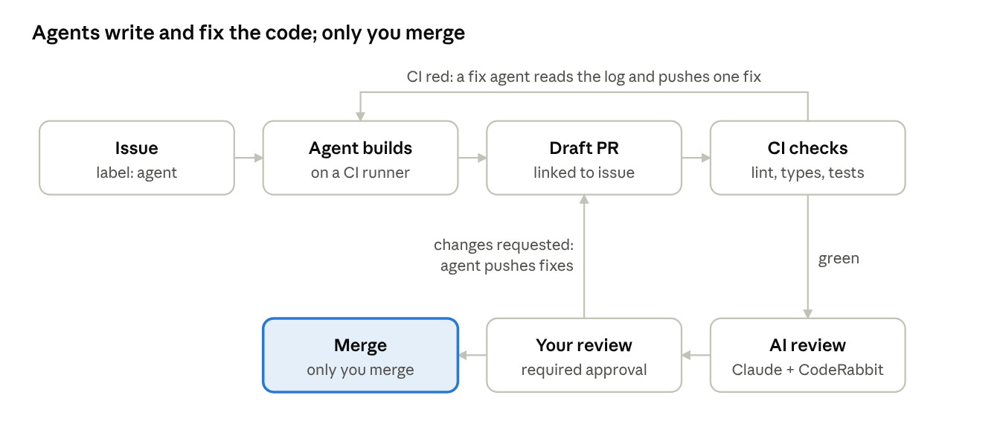
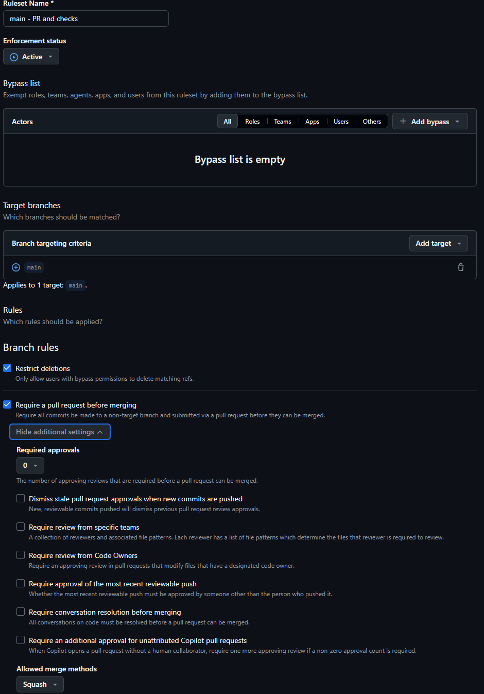
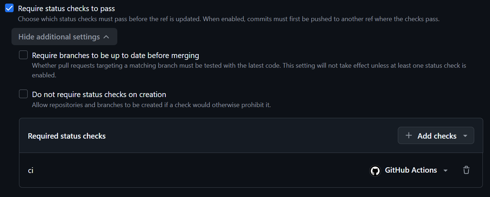
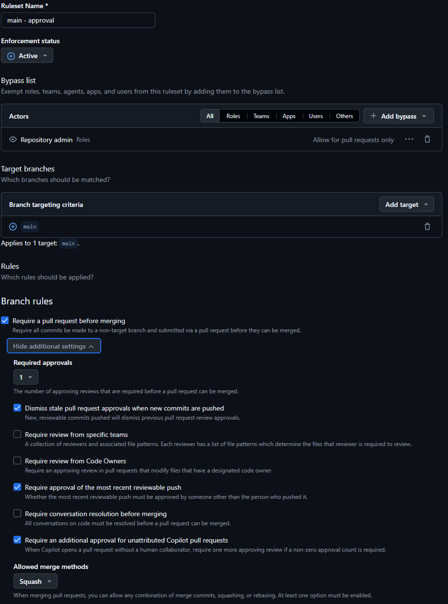
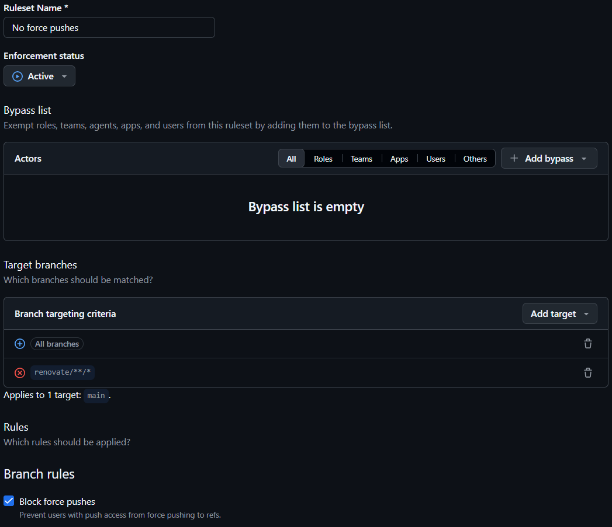
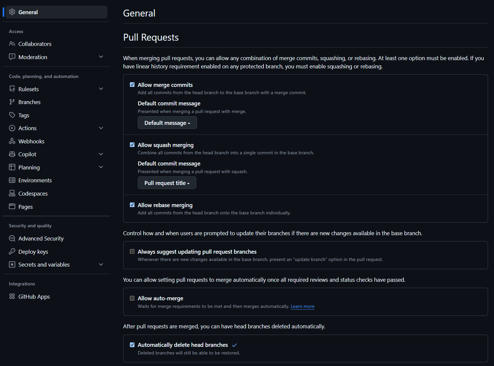

# Agents-Driven Flow: Project Plan

Nov 4, 2026 (updated Nov 11, 2026) · @Mishel

## Goal

Build one public TypeScript monorepo where agents do most of the development and you act as tech lead: you write the issues, set the rules, review and merge. The repo runs the main agent workflows engineering teams use today, so you learn where agents help, where they fail, and what makes them reliable.

The project gives you three things:

- **Agent engineering:** real evidence for agent environments, MCP integrations, an AGENTS.md you own, and enablement.
- **Full-stack practice:** React and TypeScript on a real product UI.
- **Measured results:** before/after numbers from a fixed task set.

**Done means:** a public repo anyone can clone and run, a write-up with the before/after numbers, and a list of failures you found and fixed.

## The app: a small audience sync tool

Marketers define an audience from customer data, preview it, and sync it to an ad platform. It's small enough for agents to build in days, and it covers the core data-sync problems: batching, retries, rate limits and idempotency. Keep it small: the point is the agent setup around it, not the feature count.

**Features (MVP):**

- **Customer data:** seeded Postgres tables of customers and events (purchases, page views), about 100k rows.
- **Audience builder:** a filter builder ("purchased in last 30 days AND country = DE"), a live count, and a paginated member table.
- **Sync jobs:** sync an audience to a mock ad platform that rate-limits and fails some requests. Batching, retries with backoff, idempotent writes.
- **Run history:** a page listing each sync run with status, counts and errors.

**Stack:**

| Part | Choice | Why |
| --- | --- | --- |
| Monorepo | pnpm workspaces + Turborepo | Standard for a TypeScript monorepo |
| Frontend | React + TypeScript (Vite), TanStack Query | Widely used; React practice on a real UI |
| API | Node.js + TypeScript, GraphQL Yoga (schema-first) | Same language as the frontend; a typed API for the filter builder |
| Sync worker | Small Node.js + TypeScript service | One language, so you can review every line agents write |
| Data | Postgres in Docker Compose | The only part in Docker, so agents can restart the apps directly |
| Mock destination | Tiny Node server with rate limits and random failures | Gives the sync worker real failure cases |
| Tests | Vitest, Playwright (e2e + screenshots) | Agents need fast checks to verify their own work |

**Nothing to host.** Postgres runs in Docker Compose; everything else runs as Node processes with `pnpm dev`, locally, in the dev container and in CI. Every outside service (GitHub, CodeRabbit, Renovate, Sentry) is a hosted product with a free tier.

## What this project copies from industry

Agents now cover the whole lifecycle, not just writing code. In Anthropic's 2026 State of AI Agents report, organizations reported time savings in planning (58%), code generation (59%), documentation (59%), and code review and testing (59%). The reference case is Stripe's Minions: about 1,300 agent-written PRs per week with humans mostly reviewing, built on cloud dev environments, CI, internal docs, and an MCP server with nearly 500 tools of which each agent gets a small subset. Anthropic's AI-native SDLC playbook describes the same loop, with humans approving at gates. This project copies that setup at a small scale.

| Stage | What teams do | In this project |
| --- | --- | --- |
| Plan | Turn an issue into a plan before any code | Plan mode locally; in GitHub, a plan on the issue that you approve with the `agent` label |
| Build locally | Agent in a terminal, IDE open for review | Claude Code, with parallel sessions in git worktrees |
| Delegate | Assign an issue, get a PR back | Label an issue `agent`; the agent opens a draft PR |
| AI code review | First-pass review on every PR | Claude and CodeRabbit on every push, once CI passes |
| Fix failing CI | Agent reads the failed step and pushes a fix | A diagnosis comment plus one fix attempt |
| Dependency updates | Bot opens upgrade PRs, agent fixes the breaking ones | Renovate + the CI-fix agent |
| Security review | Extra review when sensitive paths change | Triggered by changes to `services/sync-worker/`, `.github/`, `.devcontainer/`, `.claude/` or config files |
| Tests | Generate and extend tests, check UI visually | A test-writing skill; Playwright screenshots the agent looks at |
| Maintenance | Label issues, sync docs | Issue triage on open; weekly docs-sync job |
| Tool access (MCP) | Agents query CI, logs, tickets | GitHub's MCP server + one custom MCP server |
| Cloud environments | Isolated environments for agents | Dev container with a firewall, also usable in Codespaces |
| Non-engineers | Small change requests from outside engineering | An issue form in, a PR with screenshots out |

## Agent setup

Everything an agent needs lives in the repo, so any engineer, agent or CI job gets the same setup from a clone.

```
agents-review/
├── AGENTS.md                  # shared rules for every agent tool (you write it by hand)
├── CLAUDE.md                  # one line: @AGENTS.md
├── REVIEW.md                  # review rules for Claude, CodeRabbit and Copilot review
├── apps/
│   ├── web/                   # React app (later: its own AGENTS.md + one-line CLAUDE.md)
│   └── api/                   # GraphQL API
├── services/
│   ├── sync-worker/
│   └── mock-destination/
├── packages/shared/           # types, GraphQL schema
├── packages/db/               # Drizzle schema, migrations, seed
├── tools/mcp-dev/             # your custom MCP server (Phase 6)
├── docs/private/              # your notes and agent log (gitignored, denied to agents)
├── .claude/
│   ├── settings.json          # permissions, hooks
│   ├── hooks/                 # hook scripts in TypeScript, with tests
│   ├── rules/                 # Claude-only path-scoped rules
│   ├── skills/                # write-issue, fix-bug, write-tests, screenshot-ui, add-graphql-field
│   └── agents/                # subagents (if we add any)
├── .mcp.json                  # team-shared MCP servers
├── .coderabbit.yaml
├── renovate.json
├── .devcontainer/             # container + egress firewall
└── .github/
    ├── workflows/             # CI + agent workflows
    └── ISSUE_TEMPLATE/        # issue forms: feature, bug, visual change
```

**How the pieces work:**

- **AGENTS.md** is the one rule file for every tool: commands, package boundaries, conventions, "never do" rules, definition of done. Keep it short. Claude Code reads AGENTS.md only when no CLAUDE.md exists, so the root CLAUDE.md imports it, and every nested AGENTS.md needs a one-line CLAUDE.md beside it. Copilot reads AGENTS.md natively, nested ones too. Add nested files and `.claude/rules/` only when a mistake repeats.
- **Permissions** mirror AGENTS.md: deny what it says never to do, ask before what it says to ask about, allow the project checks. Agent config (AGENTS.md, CLAUDE.md, REVIEW.md, `.claude/`) is `ask` on your machine, so you can approve an edit. In the dev container, where nobody watches, a managed settings file baked into the image denies it. Only `deny` rules also cover shell writes such as `>>` redirects; `ask` rules cover only the file tools.
- **Hooks** enforce, because instructions are only context. They are TypeScript files run directly by Node, so they work on Windows and in the dev container. The Claude runs in GitHub Actions turn them off (see "Agent commands in CI"). Today there are two:
  - After each edit, Oxlint runs on the edited file.
  - Before Claude finishes, lint and typecheck must pass. The hook blocks once, then lets Claude stop with a warning, so it can't loop. `--max-turns` is the real limit in headless runs.
- **Failing test first** (Phase 5): the `fix-bug` skill writes a test that reproduces the bug, confirms it fails, then creates a gitignored lock file in the repo root. While the lock exists, a PreToolUse hook blocks edits to test files, so the agent fixes the code instead of weakening the test. That needs a hook, because a static rule can't depend on the lock. The hook covers only the Edit and Write tools, so CI backs it up: on PRs labelled `bug`, the new tests must fail on `main` and pass on the branch.
- **REVIEW.md** is the review policy: three passes (bugs, security, match with acceptance criteria), what counts as Important versus a nit, at most 5 nits, and what to skip. Copilot code review reads it automatically. CodeRabbit and the Claude Code Action don't: list it in `.coderabbit.yaml` under `knowledge_base.code_guidelines.filePatterns`, and name it in the Claude review prompt.
- **Skills** are repeatable workflows the agent pulls in when relevant. `write-issue` runs only when you call it.
- **`.mcp.json`** holds GitHub's MCP server (run from its Docker image with a fine-grained token, toolsets limited so there's no merge tool) and your custom server.
- **Dev container** starts from Anthropic's reference container. Its default-deny firewall is what makes unattended runs reasonable, and it's the only place to skip permission prompts. Claude Code's built-in sandbox isn't used: it doesn't run on native Windows. In WSL you can turn it on for yourself with `/sandbox`.

## Workflows

Every change goes through one flow: issue → agent PR → checks → your review → merge. Agents push only to their own branches, and only you merge.



Both loops send work back to an agent, not to you. You see a PR once CI is green and the AI review is in.

**Main flow** (every feature and bug fix)

| Step | Trigger | Agent | You |
| --- | --- | --- | --- |
| 1 | Issue opened | Claude labels it and asks for missing acceptance criteria | Draft it with `write-issue`; answer questions |
| 2 | You add the `agent` label. For features, comment `@claude plan` first | Claude posts a plan (features), then builds from the approved plan, runs tests and pushes; a workflow step opens the draft PR | Features: read the plan, correct it in a comment, then add the label to approve |
| 3 | CI fails | Claude reads the failed log and pushes one fix | Take over if it fails again |
| 4 | CI passes | A draft PR is marked ready. On a ready PR, Claude reviews it against REVIEW.md and CodeRabbit is asked to review; a security review runs if sensitive paths changed | Read the reviews |
| 5 | You comment `@claude fix comments...` | Claude commits the requested changes to the same branch; once CI passes, both reviews run again on the new commits | Review and ask for changes |
| 6 | You're done reviewing | — | Merge through your approval bypass (the PR is opened under your account, so you can't approve it). CI must be green |

**Side flows** (each joins the main flow at step 3)

| Flow | Trigger | Agent | You |
| --- | --- | --- | --- |
| Dependency update | Renovate opens an upgrade PR (weekly) | If CI fails, the CI-fix agent adapts the code | Approve and merge |
| Docs sync | Weekly schedule | Claude compares docs to code and opens a PR | Review and merge |
| Visual change | Someone files the "visual change" form; you add the `agent` label | Claude edits copy or styles and adds before/after screenshots | Check the screenshots, merge |

**Always on, no AI:** CodeQL, secret scanning and Dependabot alerts.

**Optional: Copilot comparison.** Needs Copilot Pro at $10 for one month; GitHub paused the free trial in April 2026, and Copilot Free has neither the cloud agent nor PR review. Nothing else in the plan depends on it, and Copilot does nothing in the repo unless you subscribe and then assign it an issue or request its review. If you do it: run 2–3 of the same issues through the Copilot cloud agent, request Copilot review on about 5 PRs, and note where each tool beats Claude and how many of its review comments are real defects.

**Setup traps** (work through these in Phase 4, and write down what you hit):

- **Tokens:** never in one job together. Claude's jobs get the Claude OAuth token and a read-only `GITHUB_TOKEN` (the action's `github_token` input), so they can change nothing. Pushes, PRs and comments use your GitHub App's token (`actions/create-github-app-token`: it lasts an hour and is revoked when the job ends): pushes made with `GITHUB_TOKEN` start no workflows, an App's do. The App's private key lives in the `publish` environment and the OAuth token in the `claude` environment, both limited to `main`, so only jobs that name the environment get them (#51).
- **Cache:** jobs started by comments, labels and `workflow_run` get read-only cache access by default (`cache-mode`), so a job that runs the branch's code can't poison `main`'s cache. Don't set `cache-mode: write` on them.
- **Checkout credentials:** set `persist-credentials: false` on `actions/checkout` in every job that runs Claude or the branch's code; only `publish` keeps the App's token for its push. Checkout v7 saves `GITHUB_TOKEN` in a separate file linked with `includeIf`, and the action only clears files linked with `include.path`, so git pushes with `GITHUB_TOKEN` instead of the app token. Found on the first `@claude fix` push ([#38](https://github.com/MiselKING/agents-review/pull/38)): CI waited for "Approve workflows to run", and the review refused `github-actions[bot]`. Fetching without the token works because the repo is public.
- **Workflow changes:** comment, label and `workflow_run` workflows always run as they are on `main`, also on a PR that changes them, so a workflow change can't be tested by its own PR. Review it yourself, and try risky parts on a throwaway branch (#51 tested the sandbox that way). The action's own Claude app token also only works when the workflow file matches `main` (#39–#41 got no answer and no review), one more reason the Claude jobs pass `github_token` instead.
- **Opening the PR:** the `publish` job opens the draft PR with the App's token. A PR opened with `GITHUB_TOKEN` waits for you to click "Approve workflows to run". The App is the PR's author, so you can approve it normally.
- **CI fix:** when CI fails, `after-ci.yml` calls `claude-work.yml` directly, with the failed jobs' logs collected before Claude starts. Earlier tries: Claude on `workflow_run` with the action's CI tools, which only load on PR and comment runs (#45–#46), then an `@claude` comment posted with a personal token. The loop guard: the App's reply carries a marker, and a later failure on the same PR finds it and stops, so there's one automatic fix per PR. It's checked twice: before the fix waits in the queue, and again when it starts, since fixes can queue behind each other. A skipped fix leaves no marker.
- **Review trigger:** run the Claude review on `workflow_run` once CI passes (`after-ci.yml`), so no runner waits for CI, and a re-run that passes still gets a review. Until #51 it ran on `pull_request` and polled CI. On `workflow_run` the action has no PR: it offers no inline-comment tool and restores no config from the base branch. So Claude only reads and returns its review with `--json-schema`, and a separate job posts it as one PR review with inline comments. Nothing there installs or runs the PR's code, which would run with `main`'s permissions and cache. The same workflow marks a draft ready with the App's token, because an event caused by `GITHUB_TOKEN` starts no workflow. CI on a push by the App was started by the App, so the review lists the App's bot (the `APP_BOT_LOGIN` variable) in `allowed_bots`.
- **Review permissions:** the generated review workflow has shipped with `pull-requests: read`, so reviews finished without posting. Only the job that posts needs write. The job Claude runs in stays read-only: Claude reads text other people wrote, and the action passes the job's token to Claude's process (#51).
- **Review secrets:** Claude's process always holds the Claude OAuth token, so text it reads can try to make it copy the token into the review, which is public. A check on the output can't catch an encoded copy. So the review gets no Bash, its file tools refuse paths outside the workspace (`blockReadsOutsideWorkingDirectories`, a `Read(//proc/**)` deny, no symlinks in `pr-head/`), and it gets only text by people with write access plus earlier reviews by our bots, collected into `pr-context/` before Claude starts.
- **Review rules:** a PR must not rewrite the rules it is reviewed by. On `workflow_run` the action restores nothing, so the review checks out `main` at the root and the PR into `pr-head/`, then removes every AGENTS.md, CLAUDE.md, REVIEW.md, `.mcp.json` and `.claude/` from `pr-head/`. Don't pass `pr-head/` with `--add-dir`: Claude Code loads skills, agents and plugin settings from added directories.
- **Plan gate:** the label-triggered run must build from the approved plan, and only someone with write access can approve: the build first checks who added the label. Tell it in the prompt to read the issue's comments, and confirm on one feature that it does. The label approves the issue, its title, description and comments as they are at that moment, and the build may wait for another Claude run first. So `claude-build.yml` records a hash of the title and description and each comment's id and last edit at once, all compared with the label event's own time, since that job starts a few seconds later. The build skips with a reply if one of them changed or was deleted after the label, or the label was removed; comments posted after the label are left out. A plan still being written when you label counts as changed, because a plan reply is an edit of an earlier "Working on it" comment.
- **Review mentions:** GitHub runs PR review and diff-comment events as the PR's merge commit, with the PR's own copy of the workflow, and the `claude` and `publish` environments only allow `main`. So `claude-review-mention.yml` only signals; `claude-mention.yml` then starts on `main` (`workflow_run`), looks up the comment or review whose id the signal run carries in its name, and trusts nothing else from that run. The item must be by the person who triggered the run, on that PR, by someone with write access, mention `@claude`, and be posted in the 5 minutes before the run, so an old id can't be replayed. With the id, each of several `@claude` comments in one review is handled once.
- **Queue:** all Claude runs on an issue or PR share one concurrency group with `queue: max`; by default a new waiting run replaces the one already waiting, which would drop a build. actionlint 1.7.12 doesn't know `queue` yet, so `.github/actionlint.yaml` ignores that one error.
- **Patch hand-off:** the patch goes between jobs as a job output, read from one environment variable, and Linux refuses a single one over 128 KiB. Larger changes fail with "split the task".
- **CodeRabbit:** it reviews as soon as you push and has no setting to wait for CI. Turn its automatic reviews off in `.coderabbit.yaml`; the review workflow comments `@coderabbitai review` with the App's token once CI passes. The command works with automatic reviews off. Its docs don't say whether it takes commands from bots: if it ignores the App, use a personal token with only Pull requests write for that one comment. The open-source plan allows 1–10 reviews per hour, and command-started reviews count.
- **Agent commands in CI:** code that runs in a job can read every secret of that job, not just its own step's: GitHub's runners give `sudo`, and the 2025 tj-actions attack read secrets from the runner's memory. Tests and project scripts run the branch's code, which Claude may have written after reading an issue anyone can open. So Claude runs no commands in a job that holds a secret, and `claude-work.yml` splits each run (#51):
  - `work`: Claude reads and edits files with the OAuth token and a read-only `GITHUB_TOKEN`. No Bash, hooks or install; the agent rules come from `main`, including `.claude/` folders at any depth; the branch's symlinks are removed first, so Claude's file reads can't follow one out of the workspace; and its context holds only comments by people with write access and by the bots you installed.
  - `check`: no secrets. Applies Claude's changes, runs codegen and format, then lint, typecheck and the unit tests, and reports them in Claude's reply.
  - `publish`: the App's token, and no Claude or install. Applies the patch, refuses agent config, `.github/`, symlinks and submodules, and stops if the branch moved. Then commits, pushes and replies.

  Claude Code's sandbox can't start on GitHub's runners (nested user namespaces are blocked), and the secret scrub (`CLAUDE_CODE_SUBPROCESS_ENV_SCRUB`) hides secrets and `sudo` from commands but not the files later steps run, so neither is used; both were tested on a runner in #51. Until the `screenshot-ui` skill exists (Phase 6), add the screenshots for UI PRs by hand.
- **Screenshots:** CI can't paste images into a PR comment. Upload them as a workflow artifact and link it, or commit them to a `screenshots` branch.
- **Schedules:** GitHub disables scheduled workflows after 60 days without repo activity.
- **Copilot PRs** (optional comparison): workflows don't run on Copilot's pushes until you click "Approve and run workflows", and your approval of a Copilot PR doesn't count.

## Guardrails

A public repo with agents that write code is an attack surface.

**Agents never merge.** Three rulesets enforce it. Rules from all rulesets on a branch are combined and the strictest applies.

| Ruleset | Applies to | Rules | Bypass |
| --- | --- | --- | --- |
| main - PR and checks | `main` | Require a PR (0 approvals), require the `ci` check, squash only, no force pushes, no deletion | None |
| main - approval | `main` | Require 1 approval | Repository admin, for pull requests only |
| No force pushes | All branches except `renovate/**/*` | No force pushes | None |

You can't approve your own PRs, so you merge them through the bypass in the second ruleset, while the first still requires CI. Renovate's PRs you approve, then merge. Renovate is excluded from the third ruleset because it rebuilds its branches on top of `main`.

<details>
<summary>Screenshots of the GitHub settings</summary>






Repo-wide PR settings (**Settings → General → Pull Requests**):



</details>

**The other rules:**

- **Only trusted people trigger agents.** Claude runs only for comments by people with write access, the `agent` label, and CI failures on PRs from this repo; the action checks the actor's access too. `allowed_bots` lists only your App's bot, so CI on its pushes can be reviewed and fixed. Never `*`, and leave `allowed_non_write_users` off.
- **A PR can't rewrite its own review rules.** See "Review rules" under Setup traps. Copilot reads its instructions from the PR's own branch, so check every PR that touches AGENTS.md or REVIEW.md yourself.
- **Scoped credentials.** The GitHub App has Contents, Pull requests and Issues write on this repo only, and no Workflows permission, so GitHub refuses its pushes to workflow files. Its tokens last an hour. Secrets live in GitHub environments limited to `main`, never in the container image. Treat the Claude OAuth token and the App's private key like passwords.
- **Public logs.** Actions logs on a public repo are public. Leave the action's `show_full_output` off.
- **Isolation.** Skip permission prompts only inside the dev container, as a non-root user. In CI, Claude runs no commands at all, and the branch's code runs only in jobs with no secrets (see "Agent commands in CI").
- **Cost and loop limits.** `--max-turns` on every headless run, at most one automatic CI-fix attempt per PR, and one automatic review per push, only after CI passes.

## Tools and cost

Everything costs $0 while the repo stays public, except the optional Copilot comparison.

| Job | Tool | Cost and limits |
| --- | --- | --- |
| Main agent, local and headless | Claude Code | Your subscription's usage limits, so run evals in batches |
| Agent workflows in GitHub | Claude Code Action with an OAuth token from `claude setup-token` | Uses your subscription, not API billing. Actions minutes are free on public repos with standard runners |
| AI reviewer | CodeRabbit | Free on public repos. A workflow triggers each review after CI passes; 1–10 reviews per hour |
| Security scanning | CodeQL, secret scanning with push protection, Dependabot alerts | Free on public repos |
| Dependency updates | Renovate (Mend app) | Free |
| GitHub tools for agents | GitHub MCP server, from its Docker image | Free; needs a fine-grained token |
| Cloud dev environment | GitHub Codespaces | 120 core-hours a month (60 hours on 2 cores) |
| Local isolation | Docker + the dev container | Free |
| Error monitoring (optional) | Sentry Developer plan + its hosted MCP server | Free for 1 user, 5k errors |
| Second agent and reviewer (optional) | Copilot cloud agent and code review | $10 for one month of Copilot Pro; cancel before it renews |

**Keep it at $0:**

- Keep the repo public. CodeRabbit, CodeQL, secret scanning and free Actions minutes depend on it.
- Authenticate the Claude Code Action with the OAuth token, never an API key.
- Run AI review only after CI passes, and use standard runners.

## Build plan

Eight phases, in order, with no fixed timeline. If time runs short, cut the custom MCP server to one tool and skip the docs-sync job, but keep Phase 7: the evals are what make the project count.

**You** = done by hand. **Agent** = Claude Code does it and you review. Log every agent failure in `docs/private/agent-log.md` with the cause and the fix; it's the most useful part of the write-up.

**Phase 1: Foundations** (done)

- ✅ **You:** public repo, first commit, the three rulesets.
- ✅ **You:** README.md, AGENTS.md, CLAUDE.md, and a `.claude/settings.json` with the first deny rules.
- ✅ **Agent drafts, you edit:** issue forms and the `write-issue` skill.
- ✅ **You:** the scaffold issue. One-time setup rules go in the issue, not in AGENTS.md.
- ✅ **Agent:** build the scaffold in plan mode. **You:** run every AGENTS.md command by hand and fix differences.
- ✅ **Agent:** CI workflow. **You:** make `ci` a required check.

**Phase 2: Environment and guardrails**

- ✅ **Agent drafts, you review:** dev container with the firewall allowlist adjusted for this repo.
- ✅ **You:** open the same config in Codespaces once.
- ✅ **Agent drafts, you review:** permissions (allow the project checks, deny agent config in the dev container) and the two hooks.
- ✅ **You:** run one headless task in the container (`claude -p ... --max-turns ... --dangerously-skip-permissions`). Confirm it can run the full test suite and that an edit to AGENTS.md is denied.
- ✅ **You:** draft the 12 eval tasks in the private repo `agents-review-evals`, before Phase 3 shows what the setup is good at.

**Phase 3: Core product features, built locally**

Four of the six product features. The other two, member table and run history page, wait for Phase 4, so the GitHub automation is proven on real issues.

- ✅ **You:** write 4 issues with `write-issue`: data model with seed data, GraphQL API, audience builder UI, sync worker with the mock destination. The data-model issue defines every table the six features need, so no later feature changes the DB schema. It also adds Postgres to the CI `e2e` job, as a service container, since that job runs inside Playwright's image.
- ✅ **Agent:** build each locally in plan mode. Data model first, then the GraphQL API, one at a time. Then the audience builder and the sync worker in parallel git worktrees, each with its own `.env` ports and database name.
- ✅ **You:** review and merge. Add `apps/web/AGENTS.md` and `.claude/rules/` only when a mistake repeats.
- ✅ **Agent drafts, you review:** the `write-tests` and `add-graphql-field` skills, once there's a pattern to copy. No reviewer subagent: the Claude review and CodeRabbit on every PR already cover it.

**Phase 4: GitHub automation**

- ✅ **You:** install the Claude GitHub app, run `claude setup-token`, store the token as a repo secret (Repository -> Settings -> Secrets and variables -> Actions -> New secret).
- ✅ **You:** create fine-grained personal token for this repo (permissions: contents write and pull requests write) and store as second secret.
- ✅ **Agent drafts, you review:** Claude Code Action workflows: `@claude`, the `agent` label to a draft PR, review after CI passes. Work through the setup traps.
- ✅ **You:** write REVIEW.md by hand. **Agent:** the step that restores REVIEW.md and every AGENTS.md before the Claude review.
- ✅ **You:** install CodeRabbit (on their page, log in with GitHub and pick the repository). Automatic reviews are off; the review workflow comments `@coderabbitai review` once CI passes. **Agent:** `.coderabbit.yaml` with REVIEW.md as a guideline file.
- ✅ **You:** write the last 2 issues with `write-issue`: member table, run history page. The run history issue also adds the "Sync now" button, which the sync worker issue left out on purpose.
- ✅ **Agent, through the main flow:** member table first, then run history page, one at a time. This is the plan-gate test: comment `@claude plan`, correct the plan, add the `agent` label, and confirm the build follows the approved plan. The CI-fix agent arrives in Phase 5, so when CI fails, comment `@claude` with the failure.
- ✅ **You:** read the reviews and merge both. Fix the workflows, not the feature PR, when the automation is what failed.
- ✅ **You:** once all six features are on `main`, record that commit as the eval snapshot and write the 3 eval bugs as patches, both in the evals repo. Never seed them on `main`.
- ✅ **You:** start the bare eval runs on the snapshot in the background: your "before" numbers.
- [ ] Optional, **you:** the Copilot comparison.

**Phase 5: Self-healing and safety**

- ✅ **Agent drafts, you review:** CI-failure workflow: a diagnosis comment plus one fix attempt.
- [ ] **You:** a GitHub App for pushes, PRs and comments, the `publish` and `claude` environments limited to `main`, and the `APP_BOT_LOGIN` variable. **Agent:** move every Claude workflow onto it (#51). **You:** then delete the personal token.
- [ ] **You:** install Renovate. **Agent:** `renovate.json` with `minimumReleaseAge` of at least 1 day, matching pnpm's own release-age default.
- [ ] **You:** turn on CodeQL and Dependabot alerts (secret scanning is already on). **Agent:** path-triggered security review and issue triage on open.
- [ ] **Agent drafts, you review:** the weekly docs-sync workflow.
- [ ] **Agent drafts, you review:** `fix-bug` skill, test-lock hook, and the CI check for bug PRs. **You:** seed one extra bug (not an eval bug) and try it.

**Phase 6: Tools and visual checks**

- [ ] **You:** create a fine-grained GitHub token for this repo only. **Agent:** add the GitHub MCP server to `.mcp.json` with limited toolsets.
- [ ] **Agent:** custom MCP server in `tools/mcp-dev` (add `tools/*` to `pnpm-workspace.yaml`) with `get_failed_ci_log` and `get_sync_run`. Optional: connect Sentry's MCP server.
- [ ] **Agent:** `screenshot-ui` skill with Playwright, then the visual-change flow end to end.

**Phase 7: Measure**

- [ ] **You:** run the eval set on the same snapshot with the full setup.
- [ ] **You:** compare against Phase 4's bare numbers; note where the setup didn't help.
- [ ] Stretch: the `run-evals` workflow.

**Phase 8: Write it up**

- [ ] **Agent drafts, you edit:** README with architecture, how to run, and each workflow linked to a real PR it produced.
- [ ] **You:** a short article: what you built, the numbers, the 5 most useful failures.

## Measurement

Run the same 12 tasks with two setups, from the same snapshot of `main`, so only the agent setup changes.

- **Bare** (Phase 4): no AGENTS.md, REVIEW.md, rules, skills, hooks or MCP, and no personal Claude config or memory.
- **Full** (Phase 7): everything from this plan.

**Where the evals live.** Everything sits in the private repo `agents-review-evals`: task texts, patches, hidden tests, reference fixes, the snapshot commit, the runner and the results. Nothing from it goes into this repo, because an agent that can read a task's tests or fix can copy the answer.

**Task set** (each a real issue with acceptance criteria):

- 3 bug fixes, on bugs you seed as patches at the end of Phase 4
- 3 small features: a new filter operator, a new column in run history, a GraphQL field end to end
- 2 UI changes: copy and layout, checked by screenshot
- 2 test tasks: raise coverage on the sync worker, add an e2e flow
- 1 refactor across packages
- 1 dependency upgrade with a breaking change. The task's patch applies the version bump and lockfile, as Renovate would, and the agent adapts the code. Agents don't install or upgrade packages in unattended runs.

**How a trial runs.** Each trial starts clean, because agents have found answers in git history and in leftovers from earlier trials.

1. Export the snapshot into a new folder without git history, and apply the task's patch if it has one.
2. Remove the agent config (bare) or copy in the current one (full), then commit everything as one fresh commit.
3. Run `claude -p` in a fresh dev container with an empty Claude config. Keep the pinned model ID (`--model`), Claude Code version, prompt and `--max-turns` the same every time; a model alias can move between Phase 4 and Phase 7.
4. Copy in the hidden tests, then grade.

**Metrics per task:**

| Metric | How to measure |
| --- | --- |
| First-try pass | Hidden tests, lint, typecheck and tests pass with no help |
| Acceptance criteria met | Checked by you against the issue |
| Time | Minutes from start to finished change |
| Tokens | From the run's output |

Run each task twice per setup, because agent output varies, and report both "passed at least once" and "passed both times". It's a small sample, so present it as "on my task set", not a general claim. A clear finding where the setup didn't help is as useful as a win.

**Stretch: evals in CI.** A `run-evals` workflow, triggered by a `run-evals` label on PRs that change AGENTS.md, REVIEW.md, skills or hooks. It builds a trial as above with the PR's agent config, runs the 3 bug tasks with `claude -p`, and grades them with the hidden tests. Three rules:

- It reads the private evals repo with a fine-grained token, and never prints task, patch or test contents: Actions logs here are public.
- It uses the CLI, not the Claude Code Action, which loads `.claude/` from `main` and would test the old config.
- Treat the result as a smoke test: 3 tasks and 1 run can't measure small changes.

## Sources

Checked on 2026-11-04 and again on 2026-11-11.

**Claude Code**

- [Memory: CLAUDE.md and AGENTS.md](https://code.claude.com/docs/en/memory), [skills](https://code.claude.com/docs/en/skills), [hooks](https://code.claude.com/docs/en/hooks), [the .claude directory](https://code.claude.com/docs/en/claude-directory)
- [Permission modes](https://code.claude.com/docs/en/permission-modes), [sandboxing](https://code.claude.com/docs/en/sandboxing), [sandbox environments](https://code.claude.com/docs/en/sandbox-environments), [dev containers](https://code.claude.com/docs/en/devcontainer), [security](https://code.claude.com/docs/en/security)
- [Headless runs](https://code.claude.com/docs/en/headless), [authentication and `claude setup-token`](https://code.claude.com/docs/en/authentication), [customizing code review (REVIEW.md)](https://code.claude.com/docs/en/code-review-customize)
- [Claude Code GitHub Actions](https://code.claude.com/docs/en/github-actions); [claude-code-action](https://github.com/anthropics/claude-code-action): [usage](https://github.com/anthropics/claude-code-action/blob/main/docs/usage.md), [security](https://github.com/anthropics/claude-code-action/blob/main/docs/security.md), [issue #944](https://github.com/anthropics/claude-code-action/issues/944)
- [GitHub Actions workflows with Claude Code](https://github.com/FlorianBruniaux/claude-code-ultimate-guide/blob/main/guide/workflows/github-actions.md) (community guide)

**GitHub and Copilot**

- [About rulesets](https://docs.github.com/en/repositories/configuring-branches-and-merges-in-your-repository/managing-rulesets/about-rulesets), [creating rulesets](https://docs.github.com/en/repositories/configuring-branches-and-merges-in-your-repository/managing-rulesets/creating-rulesets-for-a-repository)
- [Triggering a workflow (`GITHUB_TOKEN` behavior)](https://docs.github.com/en/actions/how-tos/write-workflows/choose-when-workflows-run/trigger-a-workflow), [Actions 2026 pricing](https://github.com/resources/insights/2026-pricing-changes-for-github-actions)
- [About GitHub Advanced Security](https://docs.github.com/en/get-started/learning-about-github/about-github-advanced-security), [Codespaces billing](https://docs.github.com/en/billing/concepts/product-billing/github-codespaces), [GitHub MCP server](https://github.com/github/github-mcp-server)
- [Copilot plans](https://docs.github.com/en/copilot/get-started/plans), [plan comparison](https://learn.microsoft.com/en-us/training/modules/get-started-github-copilot/3-compare-github-copilot-plans), [pausing new Copilot Pro trials](https://github.blog/changelog/2026-04-10-pausing-new-github-copilot-pro-trials/)
- [Copilot cloud agent: research, plan and code](https://github.blog/changelog/2026-04-01-research-plan-and-code-with-copilot-cloud-agent/), [what's new with the coding agent](https://github.blog/ai-and-ml/github-copilot/whats-new-with-github-copilot-coding-agent/), [AGENTS.md support, including nested files](https://github.blog/changelog/2025-08-28-copilot-coding-agent-now-supports-agents-md-custom-instructions)
- [Copilot code review](https://docs.github.com/en/copilot/how-tos/use-copilot-agents/use-code-review), [which branch it reads instructions from](https://docs.github.com/en/copilot/concepts/agent-capabilities/agent-powered-workflows-and-operations/code-review), [reviewing a Copilot PR](https://docs.github.com/en/copilot/how-tos/use-copilot-agents/cloud-agent/review-copilot-prs)

**Other tools**

- CodeRabbit: [plans and rate limits](https://docs.coderabbit.ai/management/plans), [code guidelines](https://docs.coderabbit.ai/knowledge-base/code-guidelines), [auto-review](https://docs.coderabbit.ai/configuration/auto-review)
- Renovate: [Marketplace app](https://github.com/marketplace/renovate), [updating and rebasing](https://docs.renovatebot.com/updating-rebasing/)
- Sentry: [MCP server](https://docs.sentry.io/ai/mcp/), [pricing](https://sentry.io/pricing/)
- [Sunset of the consumer Gemini Code Assist on GitHub](https://developers.google.com/gemini-code-assist/docs/deprecations/consumer-code-review) (why it isn't used here)

**Industry examples**

- [How enterprises are building AI agents in 2026](https://claude.com/blog/how-enterprises-are-building-ai-agents-in-2026) and [the AI-native SDLC playbook](https://claude.com/resources/articles/the-ai-native-sdlc-playbook) (Anthropic)
- Stripe's Minions: [Lenny's Newsletter](https://www.lennysnewsletter.com/p/how-stripe-built-minionsai-coding), [ZenML case study](https://www.zenml.io/llmops-database/ai-powered-developer-productivity-with-minions-and-machine-to-machine-payments), [summary](https://news.lavx.hu/article/inside-stripe-s-minions-how-ai-agents-are-rewriting-code-at-scale)
- [Self-correcting monorepos](https://www.elastic.co/search-labs/blog/ci-pipelines-claude-ai-agent) (Elastic), [fixing broken dependency PRs](https://ona.com/docs/examples/ai-agent-use-cases/fixing-dependencies.md) (Ona)

**Evals**

- [Demystifying evals for AI agents](https://www.anthropic.com/engineering/demystifying-evals-for-ai-agents) (Anthropic)
- [Claude 4 hacked SWE-bench by peeking at future commits](https://bayes.net/swebench-hack)
